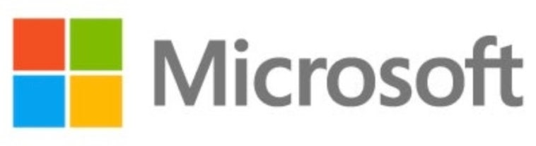

<p align="center">
  <a href="https://jinawinwin.github.io/SEC_Microsoft/">
    
  </a>
  <br>
  <a href="https://jinawinwin.github.io/SEC_Microsoft/"><b>🔗 대시보드 바로가기</b></a>
</p>

# Microsoft SEC Filings Dashboard

SEC EDGAR에 공시된 Microsoft(MSFT, CIK 0000789019)의 10-K·10-Q 데이터(XBRL)를 수집해 저장하고, 연간 · 반기 · 분기 재무 분석과 글로벌 peer firms 비교를 대시보드로 보여주는 저장소입니다.

**대시보드:** https://jinawinwin.github.io/SEC_Microsoft/

마지막 데이터 갱신: <!-- UPDATED:START -->2026-11-01 (latest 10-K/10-Q on file: 2026-10-28)<!-- UPDATED:END -->

## 대시보드 구성

| 영역 | 내용 |
|---|---|
| 상단 | 핵심 지표(KPI) 카드, 연간 매출·순이익·영업이익률, 분기 매출과 YoY, 수익성 추이, R&D vs CapEx, 현금흐름, 재무구조, 손익 Waterfall, peer 비교 차트 |
| 하단 | **연간 / 반기 / 분기** 수치 표 3종 (손익 · 현금흐름 · 주주환원 · 재무상태 · 비율) |
| 최하단 | **Global peer firms** 비교표 |
| 우측 플로팅 패널 | **PDF** 저장(대시보드 화면 그대로), **Excel** 저장(기간 선택: 연간 / 반기 / 분기 / 전체) |

## 데이터 저장 위치

| 경로 | 설명 |
|---|---|
| `data/raw/msft_selected_facts.json` | SEC companyfacts 중 대시보드에 쓰는 항목(원본 값) |
| `data/raw/msft_filings.json` | 최근 10-K / 10-Q 공시 목록 |
| `data/annual.csv` · `half_year.csv` · `quarterly.csv` | 가공된 기간별 표 (USD millions, EPS는 USD) |
| `data/peers.csv` | peer firms 최근 회계연도 스냅샷 |
| `docs/data/dashboard.json` | 대시보드가 읽는 단일 파일 |

> Q4 = 연간 − 9개월 누계, H2 = 연간 − H1, 분기 현금흐름 = 누계 차감처럼 공시에 직접 없는 값은 계산해 채우며, 표에서 `†`로 표시합니다. 자세한 규칙은 `scripts/sec_pipeline.py` 상단 주석을 참고하세요.

## 자동 업데이트 (매월 1일)

`.github/workflows/update.yml`(GitHub Actions)이 **매월 1일 00:00 UTC(한국시간 09:00)** 에 다음을 수행합니다.

1. 단위 테스트 실행
2. SEC EDGAR에서 Microsoft 및 peer firms 데이터 수집
3. `data/`, `docs/data/dashboard.json`, README의 peer 표 갱신 후 커밋
4. GitHub Pages로 대시보드 재배포

Actions 탭의 **Update SEC data & deploy dashboard → Run workflow** 로 언제든 수동 실행할 수 있습니다.

**최초 1회 설정 필요 (필수):** SEC는 담당자를 식별할 수 있는 User-Agent와 연락처를 요구합니다. 이메일만 입력하지 말고 **담당자/서비스 이름 + 실제 연락 가능한 이메일**을 함께 입력하세요 (예: `Jiyoun Lee SEC-Microsoft-Dashboard/1.0 jiyoun@example.com`). GitHub 저장소의 *Settings → Secrets and variables → Actions → Secrets → New repository secret*에서 이름을 `SEC_USER_AGENT`로, 값은 위 형식으로 등록합니다. 공개 저장소에서는 이메일 주소가 노출되지 않도록 **Variable이 아닌 Secret**을 사용하세요. 실패 시 원인은 `logs/last_failure.log`에 기록됩니다.

## Global peer firms

비교 대상은 `config/peers.json`에서 편집할 수 있습니다. 아래 표는 매월 자동으로 갱신됩니다. 금액은 각 사 보고통화 기준 백만 단위이며, 통화가 다른 기업(SAP, Alibaba)은 비율 지표만 직접 비교할 수 있습니다.

<!-- PEERS:START -->
| Company | Ticker | Region | Why a peer | FY end | Revenue (m) | Op. margin | Net margin | R&D / rev | CapEx / rev | Ccy |
|---|---|---|---|---|---:|---:|---:|---:|---:|---|
| **Microsoft** | MSFT | US | Subject company (reference row) | 2026-06-30 | 331,839 | 46.8% | 40.3% | 10.7% | 34.9% | USD |
| Alphabet | GOOGL | US | Google Cloud · Workspace · Gemini AI: direct rival in cloud, productivity and AI | 2025-12-31 | 402,836 | 32.0% | 32.8% | 15.2% | 22.7% | USD |
| Amazon | AMZN | US | AWS: the other leading hyperscale public cloud | 2025-12-31 | 716,924 | 11.2% | 10.8% | — | 18.4% | USD |
| Apple | AAPL | US | Platform and devices (OS, PC, services): mega-cap platform peer | 2025-09-27 | 416,161 | 32.0% | 26.9% | 8.3% | 3.1% | USD |
| Meta Platforms | META | US | AI infrastructure spending and open models: big-tech AI capex benchmark | 2025-12-31 | 200,966 | 41.4% | 30.1% | 28.6% | 34.7% | USD |
| NVIDIA | NVDA | US | AI accelerators: key supplier to Azure and an AI-cycle benchmark | 2026-01-25 | 215,938 | 60.4% | 55.6% | 8.6% | 2.8% | USD |
| Oracle | ORCL | US | OCI, databases, enterprise applications: cloud and database rival | 2026-05-31 | 67,357 | 30.6% | 25.4% | 15.2% | 82.6% | USD |
| Salesforce | CRM | US | CRM and enterprise SaaS: rival to Dynamics 365 | 2026-01-31 | 41,525 | 20.1% | 18.0% | 14.4% | 1.4% | USD |
| Adobe | ADBE | US | Creative and document cloud software: subscription-software benchmark | 2025-11-28 | 23,769 | 36.6% | 30.0% | — | 0.8% | USD |
| IBM | IBM | US | Hybrid cloud, AI and consulting: enterprise IT incumbent | 2025-12-31 | 67,535 | — | 15.7% | 12.3% | 1.6% | USD |
| SAP | SAP | Europe | ERP and enterprise software: rival to Dynamics ERP (files 20-F, reports in EUR) | 2025-12-31 | 36,800 | 26.1% | 19.5% | 18.0% | — | EUR |
| Alibaba Group | BABA | China | Alibaba Cloud: leading cloud provider in Asia (files 20-F, reports in CNY) | 2026-03-31 | 1,023,670 | 4.9% | 10.1% | 6.5% | — | CNY |
<!-- PEERS:END -->

## 로컬 실행

```bash
# 데이터 수집 (Python 3.10+, 외부 패키지 불필요)
SEC_USER_AGENT="Your Name your@email.com" python scripts/fetch_sec.py

# 테스트
python -m unittest discover -s tests -v

# 대시보드 미리보기
python -m http.server -d docs 8000   # http://localhost:8000
```

## 유의사항

- 데이터 출처: SEC EDGAR XBRL companyfacts API (`data.sec.gov`). 재작성(restatement)된 기간은 가장 최근 공시 값을 사용합니다.
- 합계(비차원) 값만 사용하므로 사업부문별 매출은 포함하지 않습니다. FCF = 영업현금흐름 − 유형자산 취득이며 회사 발표 수치와 다를 수 있습니다.
- 본 자료는 정보 제공 목적이며 투자 자문이 아닙니다.
